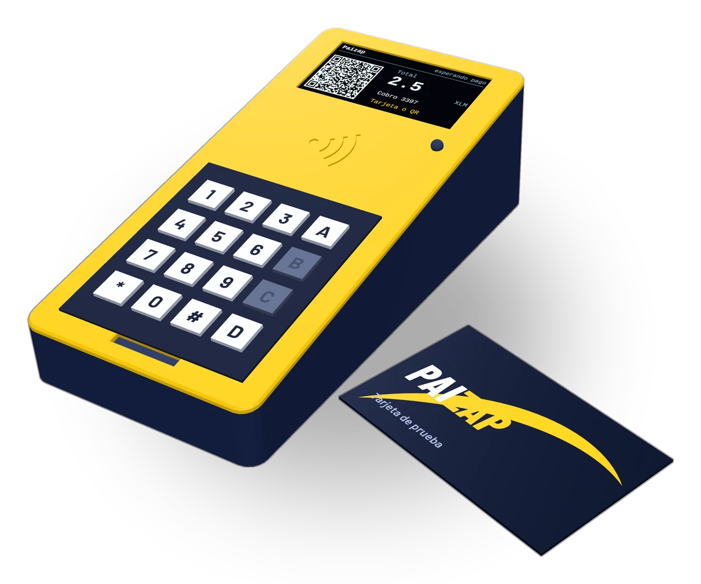
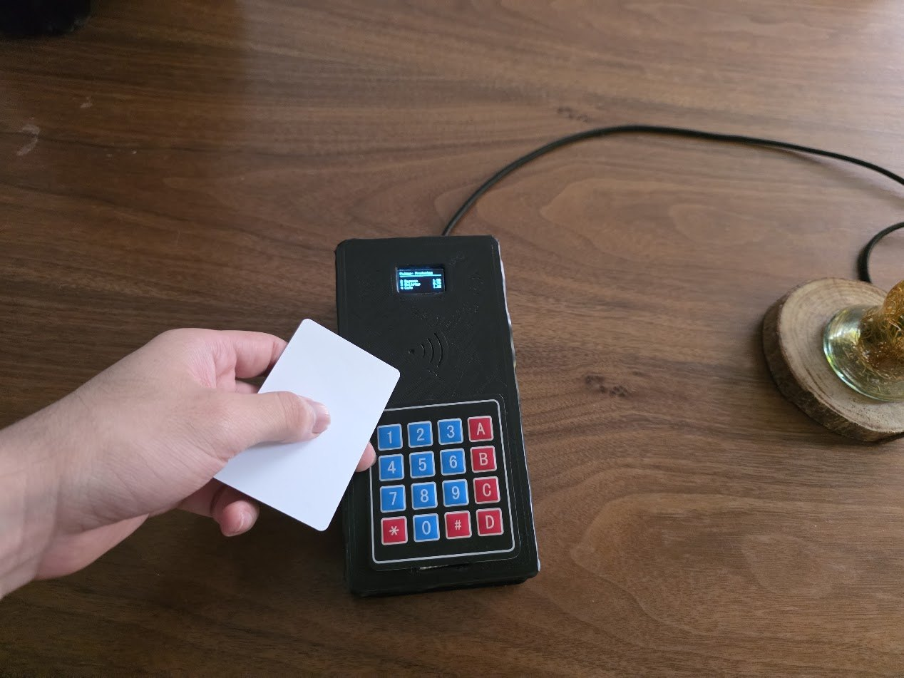
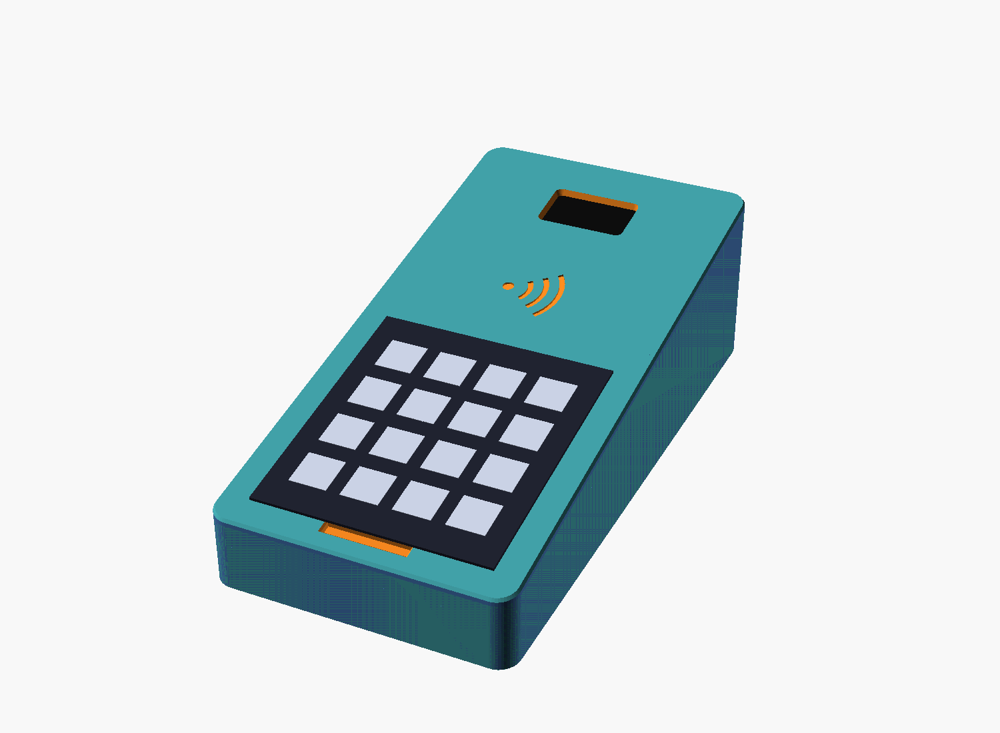
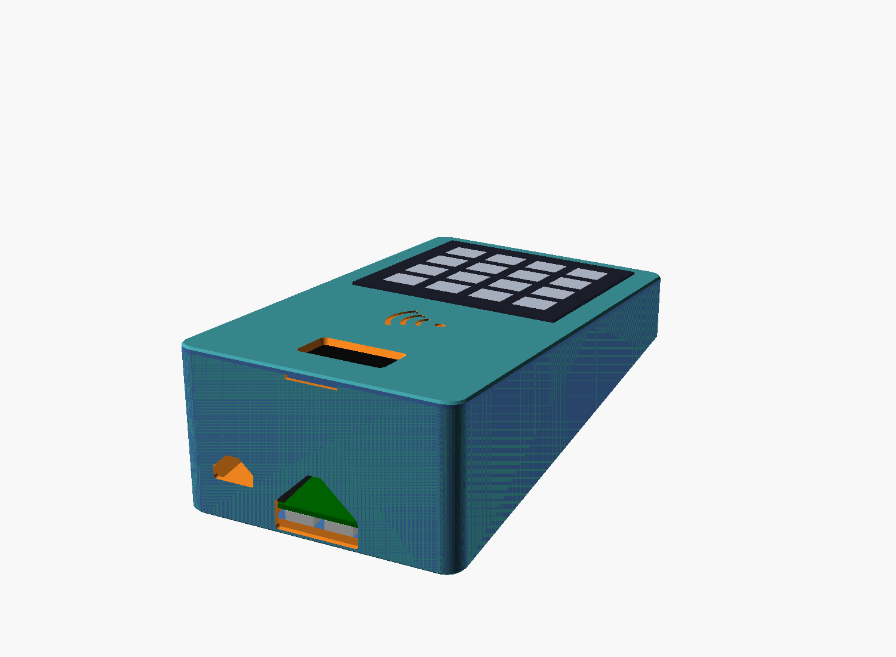

# Paizap

**Pagos de Stellar en dispositivos IoT.** Paizap lleva sistemas de pago a dispositivos IoT, como
torniquetes, dispensadores de agua, máquinas expendedoras y lavanderías. Lo hace con
**[Stellar MCU SDK](https://github.com/CoKeFish/stellar-mcu-sdk)**, su librería abierta para que un
microcontrolador cobre, confirme y firme él mismo pagos en [Stellar](https://stellar.org).

**Pruébalo:** [demo en vivo](https://paizap.vercel.app/demo/) · [video del dispositivo](https://youtube.com/shorts/vNxY6FoxzuY) · [sitio](https://paizap.vercel.app) · [documentación del SDK](https://paizap.vercel.app/sdk/)

  

<em>Modelo de la demo: un torniquete que cobra, la billetera y la tarjeta.</em>

**El producto es la librería.** Stellar MCU SDK no necesita un servidor: sus ejemplos cobran y
pagan hablando solo con un nodo público de Stellar. Paizap no vende un terminal: el terminal con
tarjeta de este repositorio es una demostración hecha con la librería.

> Estado: demo pública en vivo y librería abierta, sobre Stellar testnet. Abajo está
> [lo que ya funciona](#lo-que-ya-funciona) y la [hoja de ruta](#hoja-de-ruta).

## El problema

El IoT ya es enorme: [IoT Analytics](https://iot-analytics.com/number-connected-iot-devices/) estima
21.100 millones de dispositivos conectados en 2025 y 39.000 millones en 2030. En Latinoamérica, la
[GSMA](https://www.gsma.com/solutions-and-impact/connectivity-for-good/mobile-economy/wp-content/uploads/2024/06/The-Mobile-Economy-Latin-America-2024.pdf)
preveía en 2024 que las conexiones IoT celulares llegarían a 125 millones en 2030. Stellar ya se
ofrece para [pagos entre máquinas](https://stellar.org/x402) y nombra a los dispositivos IoT entre
sus casos.

Y las máquinas ya cobran sin efectivo. En las máquinas expendedoras de Estados Unidos y Canadá que
mide [Cantaloupe](https://www.cantaloupe.com/wp-content/uploads/2026/07/Micropayment-Trends-Report-2026-Final.pdf),
el 78 % de las ventas de 2025 fue sin efectivo. Hoy ese cobro pasa por un lector aparte: el de
[Nayax](https://shop.nayax.com/usa_en/vpos-touch.html) cuesta USD 399 por unidad en su tienda de
Estados Unidos, y la empresa
[reporta](https://ir.nayax.com/news/news-details/2026/Nayax-Reports-Second-Quarter-2026-Results/default.aspx)
una comisión de pagos del 2,62 % sobre lo que procesa. Y es un negocio grande: Nayax
[cerró 2025](https://ir.nayax.com/news/news-details/2026/Nayax-Reports-Fourth-Quarter-and-Full-Year-2025-Results/default.aspx)
con 1,46 millones de dispositivos conectados y cerca de 115.000 clientes, y Cantaloupe
[cerró su año fiscal 2025](https://www.sec.gov/Archives/edgar/data/0000896429/000162828025044777/ctlp-20251010.htm)
con 1,28 millones de dispositivos activos.

Esos dispositivos corren sobre microcontroladores. Stellar tiene SDK para la web, el celular y los
servidores; falta el que corre dentro del dispositivo.

- **Stellar no tiene un SDK para microcontroladores.** La documentación oficial lista SDK para
  JavaScript, Python, Rust, Java, Go y otros lenguajes de aplicaciones, y ninguno para
  microcontroladores ([Stellar Docs](https://developers.stellar.org/docs/tools/sdks/client-sdks)).
- **Otras redes ya lo tienen.** Bitcoin ([uBitcoin](https://github.com/micro-bitcoin/uBitcoin)),
  Ethereum ([Web3E](https://github.com/AlphaWallet/Web3E)), Solana
  ([sol](https://github.com/torrey-xyz/solduino)), Algorand
  ([Vertices](https://github.com/vertices-network/c-algorand-sdk)), IoTeX
  ([arduino-sdk](https://github.com/iotexproject/arduino-sdk)) y Sui
  ([MicroSui](https://github.com/MicroSui/microsui-lib)) tienen librería para microcontroladores
  en los registros de Arduino o PlatformIO. Stellar no tiene ninguna.
- **Hoy hay dos salidas: escribir el protocolo a mano o poner un servidor en el medio.** Así
  resuelven hoy el camino a la red los proyectos públicos que arman aparatos sobre Stellar:

  | Proyecto | Aparato | Cómo llega a Stellar |
  |---|---|---|
  | [stellar-candyman](https://github.com/sui77/stellar-candyman) | Dispensador de dulces con microcontrolador | Protocolo escrito a mano; su autor cuenta que no conoce ningún SDK de Stellar para Arduino |
  | [Alerta médica](https://github.com/arantxaamr/alerta-medica-esp32-stellar) (2026) | Botón de alerta con microcontrolador | El firmware quedó en pausa; funciona con el teléfono y un servidor |
  | [SatoshiPay](https://github.com/satoshipay/stellar-candy-dispenser) | Máquina de dulces | Node.js en una Raspberry Pi, que es un computador |
  | [soroban-pumpit](https://github.com/tupui/soroban-pumpit) (2024) | Bomba con sensores | Python en una Raspberry Pi |
  | [Kalesp](https://github.com/olivmath/kalesp) (2025) | Minero con microcontrolador | El microcontrolador calcula; el envío a Stellar lo hace un programa en Python en un computador |
  | [Sozu Offline](https://github.com/Sozu-Capital/sozu-offline) (2026) | Testigo de pagos sin conexión con microcontrolador | El microcontrolador anuncia por Bluetooth; un script en Node.js en un portátil envía la liquidación |
  | [Phonendo](https://github.com/ParriCode/phonedo) (2026) | Sensores con microcontrolador | Varios servidores firman y envían; la firma en el dispositivo está en su hoja de ruta |

  **Con Stellar MCU SDK, ese paso lo hace el propio microcontrolador:** arma, firma y envía la
  transacción él mismo, sin computador ni servidor en el medio.

- **Las librerías en C que existen son para billeteras físicas:**
  [libstellar](https://github.com/overcat/libstellar), cuyo README avisa que lleva tiempo sin
  actualizarse, y su [sucesora](https://github.com/lightsail-network/libstellar).
- **Lo poco que hay lee Horizon,** que la documentación ya da por cercano al fin de su vida útil
  ([Stellar Docs](https://developers.stellar.org/docs/data/apis)). Hace falta una pieza sobre
  Stellar RPC.

## Qué hace Stellar MCU SDK

Stellar MCU SDK existe para llenar ese hueco: darle a Stellar la librería para microcontroladores
que otras redes ya tienen. Es de código abierto y de libre uso, bajo la
[licencia Apache 2.0](https://github.com/CoKeFish/stellar-mcu-sdk/blob/main/LICENSE).

**Lo que aporta:**

- **Sin computador ni servidor en el medio.** El microcontrolador arma, firma y envía la
  transacción y habla directo con un nodo de Stellar.
- **Firma el dispositivo.** Su llave vive en él y nadie firma en su nombre.
- **Chico y rápido.** El núcleo ocupa 3,4 KB y la firma 18 KB; armar y firmar un pago tarda
  7 milisegundos.
- **Comprobado contra el SDK oficial.** 16 de sus 23 comprobaciones comparan byte a byte lo que
  arma con el SDK de JavaScript.
- **Para microcontroladores, no para un chip.** El núcleo es C portable; cada microcontrolador
  aporta solo la conexión y la criptografía.
- **Por qué Stellar dentro del dispositivo y no un QR bancario.** El QR bancario le sirve a una
  persona para pagarle a un comercio desde la app de su banco. Con Stellar, el que cobra y paga es
  el dispositivo: comprueba él mismo el pago en una red abierta, sin banco ni pasarela en el
  medio, y puede devolverlo o pagarle a otra máquina.

| Pieza | Qué hace el dispositivo |
|---|---|
| **Cobrar** | Arma el pedido de pago (SEP-7). La [demo del navegador](https://paizap.vercel.app/demo/) lo muestra como QR |
| **Confirmar** | Le pregunta a un nodo de Stellar RPC y comprueba él mismo que el pago llegó, con su monto y su número de pedido, si el pago lo trae. Entonces suena, lo muestra o activa un relé |
| **Pagar** | Guarda su llave, arma la transacción, la firma y la envía: un pago o una llamada a un contrato de token |

La librería, sus ejemplos y su documentación están en su propio repositorio:
[stellar-mcu-sdk](https://github.com/CoKeFish/stellar-mcu-sdk).

## Lo que ya funciona

En testnet, sobre un microcontrolador:

- **El microcontrolador armó, firmó y envió solo dos tipos de pago,** hablando directo con un nodo
  de Stellar RPC y sin servidor propio en el medio: un
  [pago clásico](https://stellar.expert/explorer/testnet/tx/ca284b2c462693e4b2b6cbf0169b1732d9f165d4fdfa5efa0cf512975c0d0569)
  y una
  [transferencia en el contrato del token](https://stellar.expert/explorer/testnet/tx/65894777de6cc74e886a70964700e123918b67fce4538dfe64441eda9fee8e06).
  Después detectó esos pagos consultando los eventos de la red.
- **El núcleo pasa 23 de 23 comprobaciones en el PC.** 16 comparan byte a byte lo que arma con el
  SDK oficial de JavaScript: direcciones, contratos de token, pagos, llamadas `transfer` y
  `transfer_from`, autorizaciones y filtros de eventos. Las otras 7 cubren la lectura de
  direcciones y eventos, el pedido de pago y los montos.
- **Es chico y rápido:**

| Qué | Medida |
|---|---|
| Núcleo del SDK | 3,4 KB de flash |
| Firma Ed25519 | 18 KB de flash |
| En el terminal de demostración, activar el cobro firmado | Suma 23,5 KB al firmware: el núcleo, la firma, el cliente del nodo con su certificado y la lógica del cobro |
| Armar y firmar un pago | 7 milisegundos |
| De enviar un pago a verlo confirmado | 3 a 6 segundos |
| Una consulta al nodo, con la conexión abierta | 0,3 segundos |

## Cómo está hecho

- **Un núcleo en C portable,** sin memoria dinámica y sin depender de ningún chip: direcciones,
  montos, XDR, transacciones, llamadas a contratos de token y lectura de eventos de pago.
- **Cada microcontrolador aporta solo dos cosas:** la conexión segura a internet y la
  criptografía.
- **Sobre Stellar RPC,** no sobre Horizon.
- **Librería para microcontroladores:** el núcleo no depende de ningún chip. El ESP32 es el
  primero; la hoja de ruta suma el RP2040 sin tocar el núcleo.

## La demo en un aparato real

Para probar el SDK en un aparato de verdad armamos un terminal de cobro con tarjeta NFC: un
ESP32-S3 con lector NFC, pantalla y teclado. Es una demo: está hecha para mostrar lo que el SDK
puede hacer.

  

<em>El terminal de demostración, cobrando con una tarjeta. <a href="https://youtube.com/shorts/vNxY6FoxzuY">Míralo funcionando en video</a>.</em>

  
  

<em>Modelo 3D del terminal de demostración. Los archivos para imprimirlo están en <a href="hardware/carcasa/">hardware/carcasa</a>.</em>

Lo que la demo comprobó:

- **El aparato firma el cobro él mismo.** Ya cobró con tarjeta física en testnet:
  [esta transacción](https://stellar.expert/explorer/testnet/tx/dab4fb6bd5882fc1ebc62faf4d17848e1db2ba4c8905a9ebdfbb8fab1b2cd09b)
  es uno de esos cobros, y la única firma es la del aparato.
  El dispositivo arma el cobro, lo firma y lo envía directo a un nodo de Stellar. El código
  está en [`hardware/firmware/src/firma.cpp`](hardware/firmware/src/firma.cpp).
- **Se puede cobrar con una tarjeta, que no puede firmar.** El cobro usa el permiso de gasto del
  contrato del token: el dueño de la cuenta fija un tope y un vencimiento, y la red los hace
  cumplir. La plata se queda en su cuenta hasta que paga.
- **El mismo aparato sirve de caja y de máquina.** En modo caja el vendedor escribe el monto. En
  modo de precio fijo cobra solo y activa un relé: así funcionan un torniquete, un dispensador o
  una lavadora.
- **Tiene su app de prueba,** en web y Android: la billetera de quien paga y el panel de quien
  cobra. También se paga escaneando un QR desde el celular.

## Qué hay en este repositorio

| Carpeta | Contenido |
|---|---|
| [`hardware/`](hardware/) | Electrónica, firmware y carcasa del terminal de demostración |
| [`servidor/`](servidor/) | Servidor de la demo y de la app: cobro en Stellar con el permiso de gasto |
| [`app/`](app/) | Web y app de Android de la demo: billetera y panel del comercio |
| [`sitio/`](sitio/) | La página de Paizap, la demo en el navegador y la documentación del SDK |

## Hoja de ruta

Los próximos 30 días, del 23 de noviembre al 22 de diciembre de 2026:

| Semana | Qué hacemos | Meta |
|---|---|---|
| 1 (23 al 29 nov) | Publicar la librería en los registros de Arduino y PlatformIO, con su primera versión numerada | Versión 0.1 instalable desde los dos registros |
| 2 (30 nov al 6 dic) | Llevar el mismo núcleo a un segundo microcontrolador, el RP2040 con su chip de Wi-Fi | El mismo ejemplo de pago corre en 2 microcontroladores |
| 3 (7 al 13 dic) | Los estándares de Stellar que faltan: [SEP-29](https://github.com/stellar/stellar-protocol/blob/master/ecosystem/sep-0029.md) (comprobar si la cuenta de destino exige memo antes de pagar), las cuentas multiplexadas de [SEP-23](https://github.com/stellar/stellar-protocol/blob/master/ecosystem/sep-0023.md) y más funciones de [SEP-41](https://github.com/stellar/stellar-protocol/blob/master/ecosystem/sep-0041.md): `balance`, `approve` y `allowance` | Cada estándar, con su comprobación contra el SDK oficial de JavaScript |
| 4 (14 al 22 dic) | Una funcionalidad nueva: el dispositivo paga en USDC de testnet con una llamada al contrato del token. Enviar la postulación a Stellar Instawards, por medio del capítulo local de embajadores | Ejemplo publicado y probado en testnet, con su transacción enlazada. Postulación enviada |

Dos cosas que estaban en este plan ya están publicadas: la [guía de inicio](https://paizap.vercel.app/sdk/inicio-rapido/) y el
[ejemplo que cobra con número de pedido](https://github.com/CoKeFish/stellar-mcu-sdk/tree/main/examples/esp32_standalone_device).

- **Costo del mes:** el tiempo de los dos y el hardware para probar el segundo microcontrolador:
  una placa con RP2040 y Wi-Fi cuesta [USD 6](https://www.raspberrypi.com/news/raspberry-pi-pico-w-your-6-iot-platform/).
- **Con qué se financia lo que sigue:** [Stellar Instawards](https://stellar.org/blog/ecosystem/introducing-the-stellar-ambassador-program),
  premios de hasta USD 15.000 para experimentar y hacer prototipos, que se piden por medio de
  los capítulos de embajadores de Stellar.
- **Clientes que buscamos:** integradores y fabricantes de dispositivos IoT que cobran:
  torniquetes, dispensadores de agua, máquinas expendedoras y lavanderías.
- **Regla para seguir:** librería funcionando en 2 microcontroladores y postulación enviada.

## Equipo

Un equipo que une electrónica y negocios.

| Quién | Rol | Qué aporta |
|---|---|---|
| **Rodion Tabares** ([rodion.com.co](https://rodion.com.co), [@CoKeFish](https://github.com/CoKeFish)) | Hardware y Stellar | Ingeniero electrónico. Responsable del diseño electrónico, del firmware y del desarrollo de Stellar MCU SDK |
| **Clyn Roje Quispe Villegas** | Negocio y producto | Responsable del desarrollo de negocio y del enfoque de producto. A cargo de la presentación del proyecto, la identidad de marca y la producción audiovisual |

Paizap mantiene Stellar MCU SDK, que es abierto, y hace la integración en el aparato de cada
cliente: diseña la placa del aparato cuando hace falta, o adapta la electrónica que el aparato
ya tiene.

Seguimos después de la hackathon: la postulación a Stellar Instawards sale antes del 22 de
diciembre de 2026.

---

Paizap participa en la **National Startups Hackathon by Stellar** 2026.
