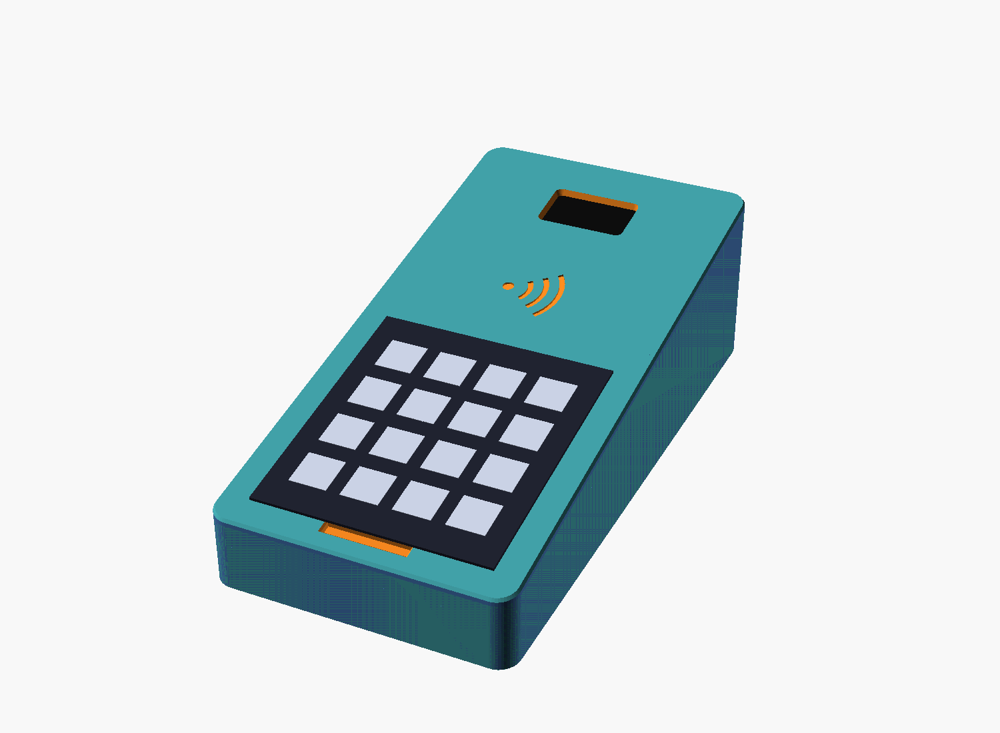
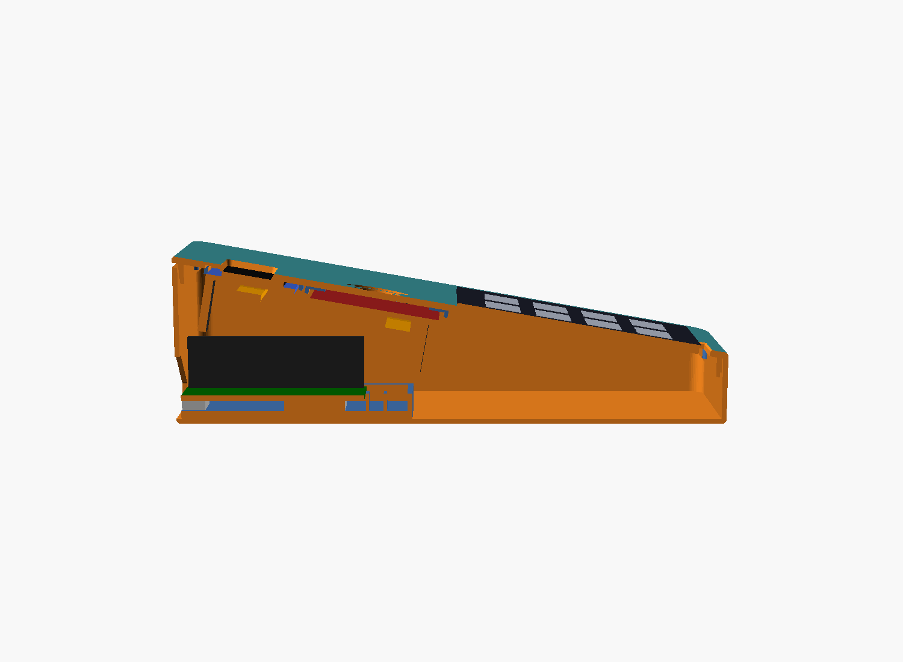

# Carcasa del terminal de demostración de Paizap

Caja inclinada de mesa para la pantalla OLED, el lector PN532, el teclado de membrana 4×4 y la
ESP32-S3, con el interior libre para los cables. Mide 86 × 172 mm, con 22,5 mm de alto al frente y
53 mm al fondo.



| Archivo | Qué es | Cómo se imprime |
|---|---|---|
| `stl/base.stl` | La caja, con la cuna de la ESP32, la ventana del USB y un pasacables | Con el piso sobre la cama |
| `stl/tapa.stl` | La tapa, con la ventana de la pantalla, el marco del lector y la ranura del teclado | Ya viene acostada, con la cara de afuera sobre la cama |
| `stl/barras.stl` | Dos barras que sujetan la pantalla y el lector | Planas, con las patas hacia arriba |
| `stl/tapa_y_barras.stl` | La tapa y las dos barras juntas, para una sola impresión | Igual que la tapa |
| `stl/todo.stl` | La base, la tapa y las barras en una sola impresión | Como viene |
| `stl/prueba.stl` | Solo la zona de la pantalla, con su barra | Igual que la tapa |

Sin soportes. PLA, boquilla de 0,4 mm, capa de 0,2 mm, 4 paredes. Son unos 120 g de plástico.

## Antes de imprimir: compara estas medidas con tus piezas

El diseño usa las medidas más comunes de cada módulo, pero cambian según el fabricante. Mide con
una regla o un calibrador; si algo no coincide, cambia el parámetro en `toki_carcasa.scad` y vuelve
a generar los archivos.

| Pieza | Medida que usa el diseño | Parámetro |
|---|---|---|
| ESP32-S3 | 27,9 mm de ancho y 57,2 mm de largo | `esp_ancho`, `esp_largo` |
| Pantalla OLED | Placa de 27,3 × 27,8 mm | `oled_ancho`, `oled_alto` |
| Pantalla OLED | 12,4 mm del borde de los pines al centro de la zona que enciende | `oled_centro_activo` |
| Lector PN532 | Lado mayor de 42,7 mm | `pn_lado` |
| Teclado | 69 × 77 mm, con la cinta saliendo por el centro del borde de abajo | `tec_ancho`, `tec_alto` |

- **ESP32 más larga:** la cuna trae topes para placas de 57, 63 y 70 mm. Si tu placa es de las
  largas, corta con un alicate el tope delgado que le estorbe.
- **Pantalla:** es la pieza con menos margen. Imprime primero `prueba.stl` y comprueba que la
  placa entre entre las guías y que la zona que enciende quede dentro de la ventana.

## Armado

1. **Teclado:** pasa la cinta con su conector por la ranura de la tapa y pega el teclado.
2. **Pantalla:** ponla entre las cuatro guías, con el vidrio contra la tapa y los pines hacia el
   borde del fondo. Empuja la barra corta sobre los dos postes hasta que toque la placa.
3. **Lector:** ponlo en el marco cuadrado, con los pines apuntando hacia adentro de la caja y del
   lado del teclado. Sujétalo con la barra larga.
4. **ESP32:** va boca abajo en la cuna, con los pines hacia arriba y los puertos USB contra la
   ventana del fondo. Los cables se conectan desde arriba.
5. Guarda los cables bajo la zona del teclado y cierra la tapa a presión. Para abrirla, haz
   palanca en la muesca del fondo.

Si una barra queda floja en los postes, dale una vuelta de cinta al poste. La tapa ajusta con
ocho nervios pequeños en el faldón: si entra muy dura, líjalos; si queda floja, pon cinta. El
pasacables del fondo sirve para sacar cables hacia un relé u otra pieza externa.

## Reglas de impresión que sigue el modelo

Están tomadas de la guía de Protolabs Network (Hubs),
[How to design parts for FDM 3D printing](https://www.hubs.com/knowledge-base/how-design-parts-fdm-3d-printing/):

| Regla de la guía | En el modelo |
|---|---|
| Voladizos de hasta 45° sin soportes | Ninguna cara pasa de 45°; los huecos de las paredes (USB y pasacables) terminan en techo a 45° |
| Puentes de menos de 5 mm para que no se descuelguen | El techo plano más ancho mide 4 mm; los grabados miden hasta 3,4 mm |
| Chaflán o radio en los bordes que tocan la cama | Chaflán en el piso de la base, en el borde, la ventana y la ranura de la tapa, y en las barras (salvo sus cortes de 1 mm) |
| Postes de menos de 5 mm: con refuerzo en la base | Postes de 5 mm con base cónica |
| Los agujeros verticales salen más pequeños | Los agujeros de las barras tienen un corte que les deja abrirse; no hay que taladrar |
| Paredes de más de 0,8 mm | La más delgada mide 1 mm (los topes que se cortan); el resto, 1,2 mm o más |

La guía no da números para holguras ni para la profundidad de los grabados. Esos valores son
criterio propio y no están probados en esta impresora: 0,4 mm entre tapa y base, 0,5 mm alrededor
de cada placa y 0,6 mm de grabado. Por eso conviene imprimir primero `prueba.stl`.

## Límites conocidos

- La ESP32 no queda atornillada: la sostienen la cuna y la pared del fondo. Sujeta la caja al
  conectar o desconectar el cable USB.
- Con la placa boca abajo, los botones BOOT y RST no quedan a la mano: para usarlos hay que
  levantar la placa.
- La antena Wi-Fi queda a unos 4 mm de la mesa. Sobre una mesa metálica la señal baja.
- Con una ESP32 de 70 mm, los cables de los dos últimos pines quedan justos bajo la barra del
  lector.

## Cambiar el diseño

`toki_carcasa.scad` es el modelo en [OpenSCAD](https://openscad.org); los parámetros están al
comienzo del archivo. Para generar de nuevo los STL y las vistas, con Docker:

```bash
sh generar.sh
```


